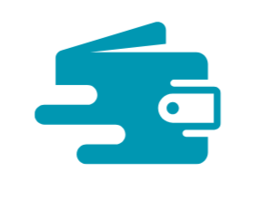
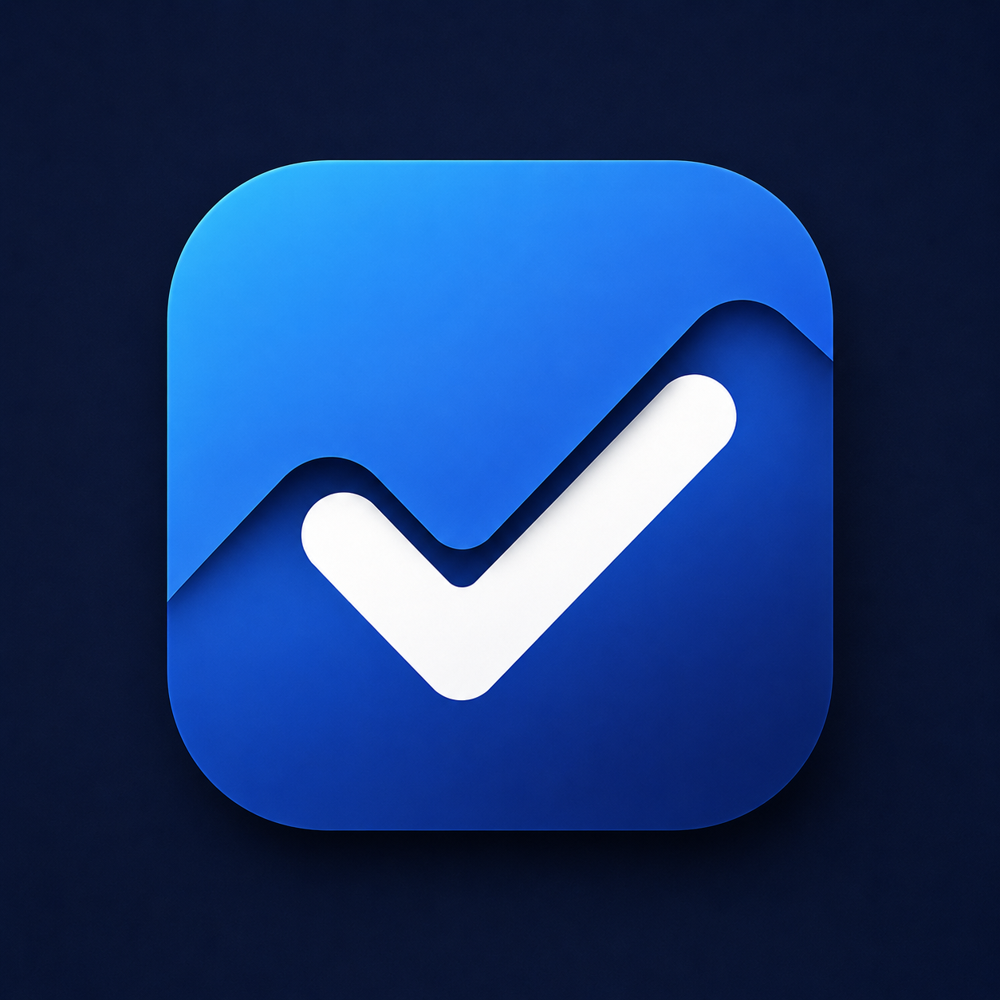
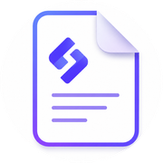
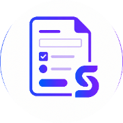
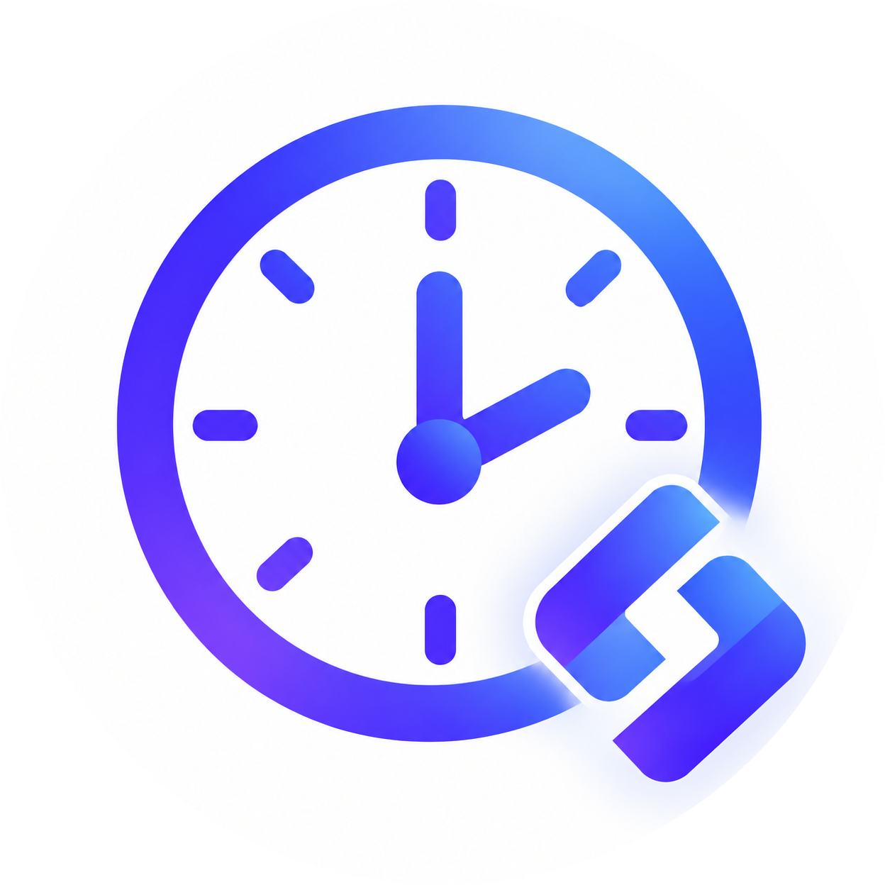

  

 

# Kacha Karan

### Software Engineer · Product Builder · AI Explorer

I design and build useful digital products - from software and APIs to automation, infrastructure, and deployment.

Based in India · Building **[Samast](https://www.samast.pro/)** · Exploring **AI-powered software**

  
  
  
  
  
  

---

## About

I'm a software engineer focused on turning ideas into useful, dependable products.

I work across application development, backend systems, databases, APIs, automation, infrastructure, and deployment. I enjoy taking products from an initial idea through development, deployment, and continuous refinement.

Currently exploring AI, machine learning, infrastructure, and developer tooling alongside modern application development.

## Current Focus

  
  
  

- Building and shipping independent products
- Software engineering and product development
- Backend systems, APIs, and database architecture
- Automation and developer tooling
- Cloud infrastructure and deployment
- Exploring AI, machine learning, and practical AI applications

## Projects

  
  

### Mobile Applications

- &nbsp; **[VaultX](https://play.google.com/store/apps/details?id=com.vaultx.vault_x)** - Secure personal vault for passwords, links, notes, and sensitive information. · `Live`
- &nbsp; **[TrustTracker](https://play.google.com/store/apps/details?id=com.trusttracker.trust_tracker_flutter)** - Personal finance app for tracking income, expenses, and everyday spending. · `Live`
- &nbsp; **[SnapDocs](https://play.google.com/store/apps/details?id=com.snapdocs.app)** - Offline document scanner and organizer with PDF management and export. · `Live`
- &nbsp; **[Divine Geeta](https://play.google.com/store/apps/details?id=com.divinegeeta.app)** - Digital Bhagavad Gita reader for exploring chapters and verses. · `Live`
- &nbsp; **[Noctune](https://play.google.com/store/apps/details?id=com.noctune.music)** - Modern offline music player designed for a clean listening experience. · `Live`
- &nbsp; **[TaskMitra](https://play.google.com/store/apps/details?id=com.taskmitra.application)** - Productivity app for organizing and managing everyday tasks. · `Testing`
- &nbsp; **[Video Downloader](https://play.google.com/store/apps/details?id=app.mediaurl.applicaiton)** - Utility app for downloading and managing supported media content. · `Testing`
- &nbsp; **[Luna](https://play.google.com/store/apps/details?id=com.luna.application)** - Personal utility and productivity application for everyday digital needs. · `Testing`
- &nbsp; **[GymBuddy](https://play.google.com/store/apps/details?id=com.gymbuddy.application)** - Fitness companion for managing workouts and training progress. · `Testing`
- &nbsp; **[Habitly](https://play.google.com/store/apps/details?id=app.habitly)** - Habit tracker for building routines and maintaining daily consistency. · `Testing`

### Web Products

- &nbsp; **[Samast](https://www.samast.pro/)** - All-in-one collection of practical web tools for everyday digital tasks. · `Live`
- &nbsp; **[Samast Pages](https://pages.samast.pro/)** - Simple platform for creating and publishing web pages. · `Live`
- &nbsp; **[Samast Forms](https://forms.samast.pro/)** - Lightweight platform for creating, sharing, and managing custom forms. · `Live`
- &nbsp; **[Samast Cron](https://cron.samast.pro/)** - Developer-focused platform for scheduling and monitoring cron jobs. · `Live`
- &nbsp; **[AutoEOD](https://autoeod.kachakaran.tech/)** - Automated end-of-day reporting platform for simplifying work updates. · `Live`
- &nbsp; **[Ledgr](https://ledgr.kachakaran.tech/)** - Lightweight digital ledger for tracking transactions and financial records. · `Live`
- &nbsp; **[Samyukt](https://www.samyukt.pro/)** - Technology platform focused on software, automation, and digital solutions. · `Live`
- &nbsp; **[Beacon](https://beacon.kachakaran.me/)** - Lightweight platform for collecting and managing application information. · `Live`
- &nbsp; **[VaultX Web](https://beacon.kachakaran.me/)** - Web companion for managing VaultX data across platforms. · `Live`
- &nbsp; **[TrustTracker Web](https://trusttracker.kachakaran.me/)** - Web companion for managing and viewing TrustTracker financial records. · `Live`

## Technology

  

| Area | Technologies |
| --- | --- |
| Software | React · Next.js · JavaScript · TypeScript |
| Backend | Node.js · Express · REST APIs |
| Databases | PostgreSQL · Supabase · MongoDB |
| Mobile | Flutter · Android |
| Infrastructure | Docker · Vercel · Render · Linux |
| Tools | Git · GitHub · CI/CD · Automation |
| Exploring | AI · Machine Learning · Deep Learning |

## GitHub

  
  
  

I use GitHub as my primary workspace for building, experimenting, maintaining, and shipping software.

[View repositories](https://github.com/kachakaran6?tab=repositories)

## What I Like Building

- Developer tools
- SaaS products
- Productivity applications
- Automation systems
- Financial utilities
- Mobile applications
- AI-powered software
- Practical web platforms

## Beyond Code

I enjoy learning by building.

Rather than only studying technologies individually, I prefer taking an idea, designing the system, writing the software, deploying it, finding what breaks, and improving it.

That process is where I learn the most.

## Let's Connect

Have an interesting product idea, technical problem, or something worth building?

  <a href="https://kachakaran.me/">Portfolio</a> ·
  <a href="https://www.linkedin.com/in/kacha-karan-5337731b2/">LinkedIn</a> ·
  <a href="https://github.com/kachakaran6">GitHub</a> ·
  <a href="mailto:kachakaran06@gmail.com">Email</a>

---

Build useful things. Keep learning. Ship thoughtfully.
